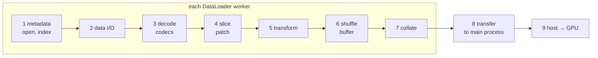

# How patch loading spends its time

A mental model of what happens between "the training loop wants a batch" and
"the batch is on the GPU", where each step can become the bottleneck, and what
storage formats and loading strategies do about it. The numbers are orders of
magnitude to build intuition, not guarantees. Measure your own setup with
`ds.plan()`, the [`JsonlProfiler`](../README.md#startup-and-io-profiling) and
`benchmarks/time_breakdown.py`.

## The path of one sample

| stage | bound by | paid per |
|---|---|---|
| 1 metadata | latency | file / key / store |
| 2 data I/O | latency or bandwidth | request / byte |
| 3 decode | CPU | chunk / byte |
| 4 slice | memory bandwidth | patch |
| 5 transform | your code | sample |
| 6 shuffle buffer | memory | sample held |
| 7–8 collate + transfer | memory copy, IPC | batch |
| 9 host → GPU | PCIe | batch |

Each stage has a different unit of cost: per file, per request, per byte, per
chunk, per patch or per batch. A loader is fast when the expensive units are
paid rarely and amortized over many samples.

### 1. Metadata: finding the data

Before reading a byte, the reader has to know where the bytes are.

- **Filesystem metadata.** Every `open`, `stat` and directory listing is a
  round trip to the filesystem's metadata service. On a local disk that is
  microseconds. On a parallel filesystem (GPFS, Lustre) it is a network round
  trip to a shared metadata server, often 0.1–10 ms, and much worse when
  thousands of processes hammer it at once. *A format with one file per chunk
  pays this per chunk.*
- **Format metadata.** Zarr reads a small JSON document per array (`zarr.json`,
  or `.zarray` + `.zattrs` in v2). Consolidated metadata puts them all in one
  file. HDF5 and netCDF read a header and walk a B-tree to find chunks. Sharded
  zarr reads a small index at the end of each shard.
- **Store opens add up.** One cube opened once is negligible. Hundreds of
  stores opened lazily in every DataLoader worker can take tens of seconds per
  epoch start. That cost is paid again whenever workers are recreated.

*zarrpatch:* opens each store once per process and caches readers
(`MultiCubeReader`). It encourages sharding (fewer files) and persistent
workers (opens paid once per run), and `ds.plan()` reports expected store
opens.

### 2. Data I/O: moving bytes

- **Latency vs bandwidth.** Every read request has a fixed cost (a syscall, a
  network round trip, a disk seek) plus a per-byte cost. Small reads are
  latency-bound: reading 1,000 × 64 KiB is far slower than 1 × 64 MiB. Parallel
  filesystems and object stores reward large, few requests. Object stores (S3,
  GCS) have ~10–100 ms latency per request.
- **Caches.** The OS page cache (and GPFS's pagepool) keeps recently read file
  data in RAM. A "warm" second epoch may never touch the disk. This makes
  benchmarks lie unless warm and cold runs are separated. On GPFS, cold reads
  can't even be forced without admin rights.
- **Random vs sequential.** Random patches spread over a large cube defeat
  readahead and caches. Every patch can land in a different part of the files.

*zarrpatch:* sorts each epoch's random patches by storage block and reads each
block group with **one** region read. The number of I/O requests scales with
blocks touched, not with patches.

### 3. Decompression: CPU per chunk

Compressed data must be decoded in whole **chunks**. That is the smallest unit
a codec can decompress, even if you only need one pixel of it. Typical
codecs decode at roughly 0.5–2 GB/s per core (zstd, lz4, blosc), gzip much
slower. Two things inflate this cost:

- **Read amplification.** Reading a 64×64 patch from 512×512 chunks decodes
  64× more data than needed. With random access, each chunk is decoded again
  for every patch that touches it.
- **Per-chunk overhead.** Libraries pay a fixed Python/bookkeeping cost per
  chunk on top of the codec. With small chunks it can exceed the decoding
  itself. In zarr-python it is the main cost of grouped reads, which is what
  the TensorStore backend removes.

*zarrpatch:* decodes each chunk **once per group** and serves every patch in it
from that buffer. `ds.plan()` reports decoded bytes vs bytes actually needed.
`backend="tensorstore"` cuts the per-chunk overhead.

### 4. Slicing: assembling the patch

The patch is cut out of the decoded block and copied into its own contiguous
array. This is a memory-bandwidth cost per patch. A patch that crosses a
block edge needs a slightly larger read region (the "halo" of `patch - 1`), so
neighbouring groups both decode the chunks on their shared edge. Grouping by
several chunks (a shard, or `group_block`) makes that overlap small.

*zarrpatch:* once reads are grouped, this copy is often the largest remaining
CPU cost. It is the floor of the pipeline.

### 5. Transform: user code

Normalization, masking, channel stacking and augmentation run per sample, in
the worker. They are often slower than the read, and they can *grow* the
sample (e.g. stacking derived channels). Every later stage then pays for the
bigger sample.

### 6. Shuffle buffer: decorrelating samples

Block-grouped reading yields patches in block order: neighbours in space and
time arrive together. A **shuffle buffer** holds N samples and emits a random
one as each new sample arrives. This restores randomness within a window of
N samples, at the cost of:

- **Memory:** N transformed samples per worker.
- **Start-up latency:** a worker emits nothing until its buffer is full.
- **Bounded mixing:** with an `IterableDataset`, each batch comes from a
  single worker. So a batch can only mix samples that went through that
  worker's buffer.

*zarrpatch:* `shuffle_buffer` (default 2048), plus block order randomized per
epoch and per worker. `ds.plan(batch_size=...)` reports how well batches mix.

### 7–8. Collate and transfer to the main process

`DataLoader` workers are separate processes. Each batch is collated (one
allocation and copy into stacked tensors), then moved to the main process
through shared memory, with the tensor handles pickled over a queue. This has
a ceiling that no reader can beat: roughly 2–4 GiB/s in total, and for small
samples a few thousand to ~10k samples/s regardless of the number of workers.
Far below that ceiling, workers scale the earlier stages across CPU cores.

### 9. Host to GPU

`pin_memory=True` lets the copy to the GPU run asynchronously, at ~10–25 GB/s
over PCIe. This is rarely the bottleneck for patch training, unless the GPU
step is very short.

### The GPU waits for the slowest stage

The stages run as a pipeline: workers prepare batch *k + 1* while the GPU trains
on batch *k*. Steady-state throughput is set by the slowest stage, divided by
how many processes share it. Start-up costs (opens, buffer fill) are not
overlapped. They show up as GPU-idle time at the start of every epoch.

## Storage formats and what they address

| format | layout | addresses | costs |
|---|---|---|---|
| **netCDF4 / HDF5** | one file, internal chunks + B-tree index | single file (cheap on metadata), mature tooling, optional compression | the library has a global lock, so concurrency means processes, not threads; chunks are often too large or contiguous for random patches; the header is parsed per open |
| **zarr v2 / v3 (unsharded)** | one object (file) per chunk + JSON metadata | parallel and cloud-native access, any chunk read independently, many codecs | millions of small files crush parallel-filesystem metadata servers and object-store request budgets |
| **zarr v3 sharded** | many chunks packed into one shard file with an index | keeps small *decode* units (chunks) while making *storage* units (files) large | an extra index read per shard; writes are whole shards |
| **zip store** (`.zarr.zip`) | a whole zarr store in one zip archive | one file to move, list and open | the central directory is parsed per open; appending is awkward |
| **virtual references** (kerchunk) | a JSON/parquet map of byte ranges inside existing netCDF/HDF5/GRIB files | a zarr view of archives without converting them | inherits the source chunking; the reference file can be large |
| **per-sample files** (`.pt`, `.npy`) | one pre-cut sample per file | trivially simple loading, no decode | redundant disk (overlapping patches stored many times), one file open per sample, geometry frozen at preprocessing time |
| **tar shards** (WebDataset) | pre-cut samples concatenated into large tar files, read sequentially | streaming at full bandwidth, few files, works on object stores | random access gone (shuffle comes from buffers and shard order); preprocessing pass; samples and geometry frozen |
| **memory map** (raw `.npy`, contiguous HDF5) | uncompressed contiguous array mapped into memory | no decode, no per-read syscall, the OS page cache shared between processes | uncompressed (largest on disk); fast only while the data fits in page cache or on fast local disk |

Two ideas run through the whole table:

- **Decode unit vs storage unit.** Small chunks keep random reads from decoding
  waste. Large files keep the filesystem and object store happy. Sharding is
  the one format that lets you choose both independently.
- **Flexibility vs preprocessing.** Formats that pre-cut samples (per-sample
  files, tar shards) are fast because the hard work was done once, offline.
  They lose the ability to change patch size, sampling or splits without
  re-running it. Reading patches live from the cube keeps that freedom, and
  pays at read time.

## Loading strategies and what they address

| strategy | addresses | watch out for |
|---|---|---|
| **naive per-sample reads** (`ds.isel(...)` in `__getitem__`) | simplest possible code; perfect randomness | every sample pays metadata + I/O + decoding of whole chunks; read amplification is maximal |
| **block-grouped reads** (zarrpatch) | each chunk decoded once per group; I/O requests per block, not per patch | needs a shuffle buffer to restore randomness; the halo means grouping by *several* chunks |
| **shuffle buffer** | randomness after grouped or sequential reads | memory = buffer × sample size × workers; start-of-epoch latency; mixing bounded per worker |
| **read-ahead / prefetch** | overlaps the next group's I/O + decode with slicing the current one | one extra group in memory |
| **DataLoader workers** | parallel decode and transform across CPU cores | process start-up; per-worker copies of everything loaded eagerly; the transfer ceiling |
| **persistent workers** | pays opens and imports once per run, not per epoch | memory stays resident between epochs (including during validation) |
| **`forkserver` / `spawn` start methods** | avoids inheriting locked thread pools (and TensorStore's fork abort) | slower start-up; everything sent to workers must pickle |
| **materialized snapshots** (`materialize()` → HDF5) | a fixed validation set read at memory speed, identical every epoch | disk space; frozen samples; for small samples in-process reading beats workers |
| **chunk caches** | repeated reads of the same chunks | only help if the cache holds most of the cube; a random-access epoch otherwise evicts before reuse |
| **faster engines** (TensorStore) | per-chunk overhead of the Python stack | fork safety; another dependency |

## Choosing a setup

1. **Layout first.** Pick chunks about the size of a patch along patched dims (the
   decode unit) and shards large enough to keep file counts low (the storage
   unit). `recommend_layout()` computes both.
2. **Group reads by several chunks.** Shards do this automatically. Otherwise
   pass the `group_block` that `recommend_layout()` suggests.
3. **Size the shuffle buffer for mixing *and* memory.** Keep it well below a
   worker's per-epoch share and check `ds.plan(batch_size=...)`.
4. **Use workers for live reads, and think twice for snapshots.** Use
   persistent `forkserver` workers for live cubes. For a materialized snapshot of
   small samples, in-process reading can beat any number of workers.
5. **Measure the stage you suspect** before optimizing the one you don't:
   `ds.plan()` for decoded bytes, `JsonlProfiler` for opens and first batches,
   `benchmarks/time_breakdown.py` for the per-stage split.

## A measured example

`benchmarks/time_breakdown.py` times stages 2–7 for one warm epoch in a single
process ([`results_breakdown.md`](../benchmarks/results_breakdown.md)). On a
137 MiB zstd cube with 4,000 random 5×64×64 patches:

| stage | one group per chunk | groups of several chunks |
|---|---:|---:|
| plan (corners + grouping) | <1% | ~1% |
| read: I/O + decompression + zarr-python overhead | ~60% | ~30% |
| slice patches out of decoded blocks + shuffle | ~35% | ~60–65% |
| collate | ~1% | ~3–7% |

With one group per chunk, decompression is only a quarter of the read stage,
and per-chunk overhead is most of the rest. Grouping by several chunks cuts the
read stage ~4×, which leaves the patch copy as the largest cost.
